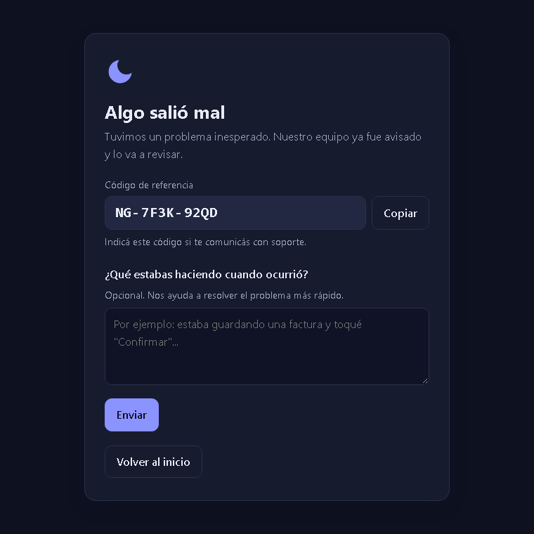
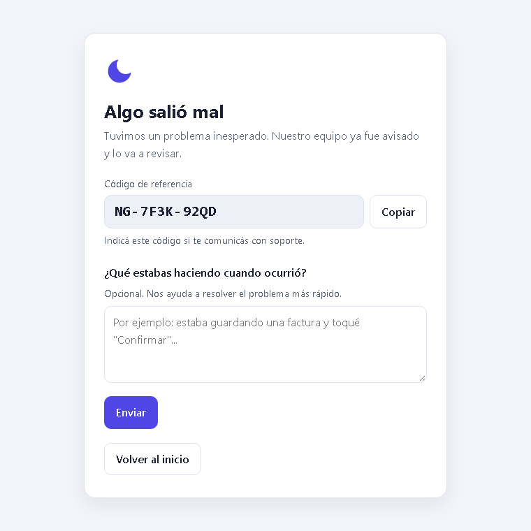

# 🌙 NightGuardian para Laravel

[](https://github.com/pablozagni/nightguardian-laravel/actions/workflows/ci.yml?query=branch%3A1.x) [](https://packagist.org/packages/nightguardian/laravel) [](https://packagist.org/packages/nightguardian/laravel) [](LICENSE)

[nightguardian.com.ar](https://nightguardian.com.ar) · [Demo en vivo](https://nightguardian.com.ar/try)

<p align="center"><a href="https://nightguardian.com.ar"></a></p>

SDK oficial de Laravel para [NightGuardian](https://github.com/pablozagni/nightguardian), monitoreo de
errores self-hosted y open source.

- **Laravel 5.8 a 13.** Un solo paquete, dos líneas (1.x y 2.x); Composer elige la correcta.
- **Sin dependencias** fuera de Laravel (usa ext-curl).
- **Nunca frena ni rompe tu app.** Envía después de responder, timeout de 2 s, corte automático y cola en
  disco si el colector no responde. No necesita queue worker ni cron.
- **Página de error amable** con código de referencia y un campo "¿qué estabas haciendo?".
- **Privado por defecto.** Contraseñas, tokens, cookies y cabeceras de autorización nunca salen del server.

## Instalación

```bash
composer require nightguardian/laravel
```

En `.env`:

```dotenv
NIGHTGUARDIAN_URL=https://nightguardian.tu-dominio.com
NIGHTGUARDIAN_TOKEN=          # se crea en el colector: Proyecto → Tokens
```

Probar:

```bash
php artisan nightguardian:test
```

Marcar un deploy desde tu script de actualización: `php artisan nightguardian:deploy`.

## Página de error amable

Cuando un error inesperado termina en un **500** en una petición **HTML** y `APP_DEBUG=false`, el visitante ve una
página chica y autocontenida (CSS en línea, sin recursos externos, modo claro y oscuro, español e inglés) con un
**código de referencia** como `NG-7F3K-92QD` y un campo opcional "¿qué estabas haciendo?". El mismo código queda en el
evento del panel: el usuario te lo pasa y encontrás el error exacto en segundos.

| Claro | Oscuro |
|---|---|
|  |  |

- Solo reemplaza la respuesta de errores que NightGuardian capturó; las excepciones ignoradas, los errores del cliente y
  todo lo demás conservan las páginas de tu aplicación. Las peticiones JSON nunca se modifican: solo reciben la
  cabecera `X-NightGuardian-Reference`.
- El comentario llega al panel como feedback, vinculado al evento original. La página de agradecimiento dice la verdad:
  *enviado* si el colector lo aceptó, *registrado* si quedó en la cola en disco porque el colector no responde.
- La ruta del comentario no usa sesión, cookies ni token CSRF (justo la sesión puede ser lo que está roto). Se protege
  con un token firmado de 15 minutos y un límite de 5 mensajes por minuto por IP.
- Se apaga con `NIGHTGUARDIAN_ERROR_PAGE=false` o se oculta el cuadro con `NIGHTGUARDIAN_FEEDBACK=false`. Textos y vista
  se personalizan con `php artisan vendor:publish --tag=nightguardian-views` / `--tag=nightguardian-lang`.

## Rendimiento

NightGuardian nunca trabaja antes de que tu respuesta esté lista: los eventos se acumulan en memoria y se envían cuando
termina la petición, con 1 s para conectar y 2 s en total. Tras una falla, un corte automático detiene los intentos por
60 s (se duplica hasta 15 min) y los eventos esperan en una cola en disco: una caída del colector cuesta ~0 a tus
peticiones.

Una salvedad depende de cómo corre PHP:

- **PHP-FPM (recomendado):** la respuesta llega al navegador antes de que el SDK envíe nada (`fastcgi_finish_request`).
  El visitante nunca espera, ni siquiera con el colector caído.
- **`mod_php` (Apache sin PHP-FPM, por ejemplo un Laragon por defecto):** PHP no puede liberar la conexión antes de
  terminar. La primera vez que el colector está caído, el navegador puede esperar **hasta ~1 s más** (el timeout de
  conexión) hasta que la petición completa. Después el corte se abre y las siguientes peticiones no se demoran. Si
  importa, bajá `NIGHTGUARDIAN_CONNECT_TIMEOUT` o pasá a PHP-FPM.

Ver [configuración](docs/configuration.md) y [cómo funciona](docs/design.md).
