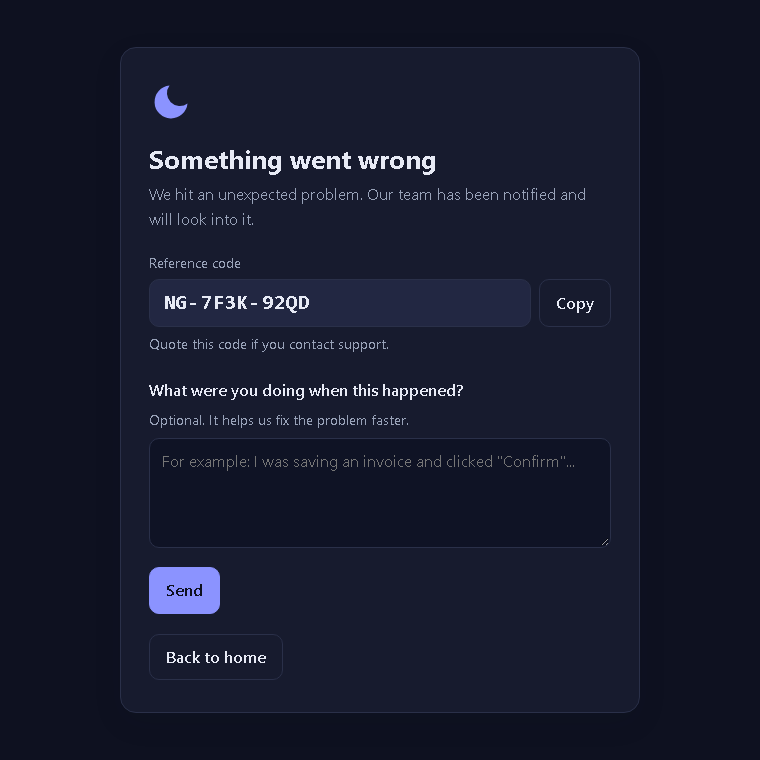
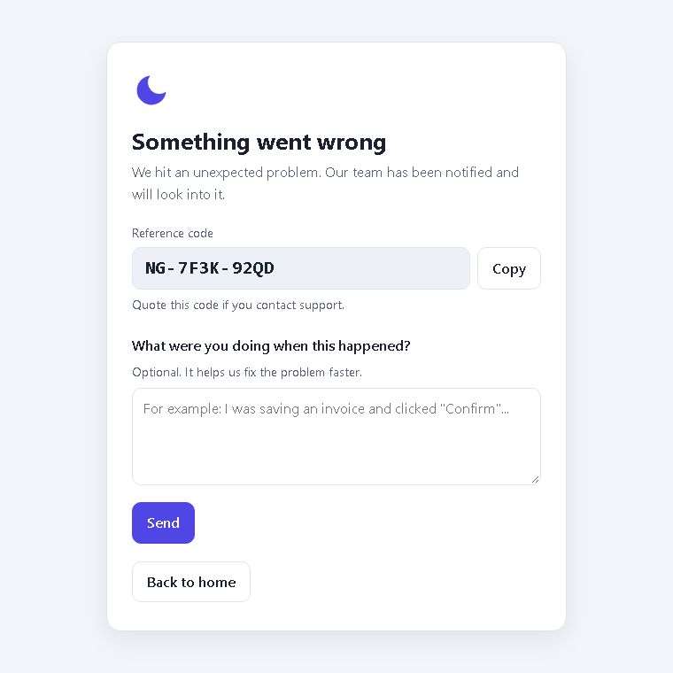

# 🌙 NightGuardian for Laravel

[](https://github.com/pablozagni/nightguardian-laravel/actions/workflows/ci.yml?query=branch%3A1.x) [](https://packagist.org/packages/nightguardian/laravel) [](https://packagist.org/packages/nightguardian/laravel) [](LICENSE)

[nightguardian.com.ar](https://nightguardian.com.ar) · [Live demo](https://nightguardian.com.ar/try)

<p align="center"><a href="https://nightguardian.com.ar"></a></p>

Official Laravel SDK for [NightGuardian](https://github.com/pablozagni/nightguardian) — self-hosted,
open source error & health monitoring.

[Español](README.es.md) · [Configuration](docs/configuration.md) · [How it works](docs/design.md) · [Compatibility](docs/compatibility.md)

- **Laravel 5.8 → 13.** One package name, two release lines (1.x and 2.x); Composer picks the right one.
- **Zero dependencies** beyond Laravel itself (uses ext-curl). No Guzzle version conflicts.
- **Never slows down or breaks your app.** Sends after the response, 2 s timeout, circuit breaker,
  on-disk queue when the collector is unreachable. No queue worker or cron required.
- **Friendly error page** with a reference code and an optional "what were you doing?" box.
- **Private by default.** Passwords, tokens, cookies and auth headers never leave your server.

## Install

```bash
composer require nightguardian/laravel
```

```dotenv
NIGHTGUARDIAN_URL=https://nightguardian.example.com
NIGHTGUARDIAN_TOKEN=          # create it in your collector: Project → Tokens
```

```bash
php artisan nightguardian:test
```

Laravel's package auto-discovery registers everything. Publishing the config is optional:
`php artisan vendor:publish --tag=nightguardian-config`.

## What gets captured

| | Default |
|---|---|
| Unhandled exceptions | ✅ |
| `Log::error()` and above | ✅ (`NIGHTGUARDIAN_LOG_LEVEL`) |
| Failed queued jobs | ✅ |
| Failed scheduled tasks | ✅ |
| Slow requests (> 2 s) | ✅ (`NIGHTGUARDIAN_SLOW_REQUEST_MS`, 0 = off) |
| Slow queries (> 1 s) | ✅ (`NIGHTGUARDIAN_SLOW_QUERY_MS`, 0 = off) |
| Deploy markers | `php artisan nightguardian:deploy` in your deploy script |

Report manually:

```php
use NightGuardian\Laravel\Facades\NightGuardian;

NightGuardian::report($exception, ['invoice' => $invoice->id]);
NightGuardian::message('Payment gateway answered late', 'warning', ['gateway' => 'mp']);
```

## Commands

| Command | |
|---|---|
| `nightguardian:setup` | Writes the URL and token to `.env`, checks the connection |
| `nightguardian:test` | Sends a test event and shows the collector's answer |
| `nightguardian:status` | Config check, spool size, circuit breaker state |
| `nightguardian:flush` | Sends everything waiting in the spool now |
| `nightguardian:deploy` | Records a deploy (release, commit, branch) |

## One app, many installations

A SaaS where every customer runs its own copy of the same app (one folder, one `.env`, one domain each) is the same code
reporting the same bugs from many places. Choose how the collector should see them:

| | **A. One shared token** | **B. One token per installation** |
|---|---|---|
| Collector | one project | one project per installation |
| The same bug in 30 installations | **one issue** (30× the events) | 30 issues, one in each project |
| Where does it happen? | the panel lists the affected **hosts** | the project is the installation |
| Alerts | once per new bug | once per installation |
| Access control | everybody sees everything | give each team or customer only its project |
| Retention, rate limit, tokens | shared | independent |

**Pick A** when you own and operate the app and want to fix bugs once: you care about *what* breaks and *how widely*.
**Pick B** when installations are operated or paid for separately, customers may see their own project, or one noisy
installation must never hide or rate-limit the others.

Every event carries a `host` tag automatically: the host of `APP_URL` (e.g. `yapai.head-office.com.ar`), also on jobs, the
scheduler and logs. It is what lets model A tell the installations apart. Set `NIGHTGUARDIAN_HOST_TAG=false` to turn it
off; a `host` tag you set yourself (in `config/nightguardian.php` → `tags`, or per event) is always respected. Make sure every
installation has its own `APP_URL`.

### Connect an installation

```bash
php artisan nightguardian:setup --url=https://ng.example.com --token=ng_...
```

Without options it asks for the URL and the token (hidden). It checks the token starts with `ng_` and the URL is `https://`
(plain `http://` only warns), writes `NIGHTGUARDIAN_URL` and `NIGHTGUARDIAN_TOKEN` to the `.env` (the rest of the file,
its permissions and its owner are untouched), caches the configuration again if it was cached, and sends a test event
(skip it with `--no-test`). It never prints the token, can be run again safely and exits with an error code if anything fails.

### Many installations on one server

Run it as the user that owns each `.env` so the files keep their owner. Model A (one shared token):

```bash
read -rsp "Project token: " TOKEN; echo
for app in /var/www/customer-*/; do
  echo "== $app"
  (cd "$app" && sudo -u www-data php8.3 artisan nightguardian:setup --url=https://ng.example.com --token="$TOKEN") || echo "FAILED: $app"
done
unset TOKEN
```

Model B (a token per installation, asked one by one):

```bash
for app in /var/www/customer-*/; do
  read -rsp "Token for $(basename "$app"): " TOKEN; echo
  (cd "$app" && sudo -u www-data php8.3 artisan nightguardian:setup --url=https://ng.example.com --token="$TOKEN") || echo "FAILED: $app"
done
unset TOKEN
```

The token is briefly visible in the process list while each command runs; on a shared server prefer typing it when the
command asks for it.
## Friendly error page

When an unexpected error ends in a **500** on an **HTML** request and `APP_DEBUG=false`, visitors see a small,
self-contained page (inline CSS, no external assets, light and dark mode, English and Spanish) with a
**reference code** like `NG-7F3K-92QD` and an optional "what were you doing?" box. The same code is attached to the
event in your panel, so a user can quote it to support and you find the exact error in seconds.

| Light | Dark |
|---|---|
|  |  |

- It only replaces the response for errors NightGuardian captured; ignored exceptions, client errors and everything
  else keep your application's own pages. JSON requests are never changed, they only get an
  `X-NightGuardian-Reference` header.
- The comment arrives in the panel as feedback, linked to the original event. The thank-you page tells the truth:
  *sent* when the collector accepted it, *recorded* when it was queued on disk because the collector is unreachable.
- The feedback route has no session, cookies or CSRF token (the session may be what is broken). It is protected by a
  signed, 15-minute form token and a limit of 5 messages per minute per IP.
- Turn it off with `NIGHTGUARDIAN_ERROR_PAGE=false` or hide the box with `NIGHTGUARDIAN_FEEDBACK=false`. Customise the
  texts and the view with `php artisan vendor:publish --tag=nightguardian-views` / `--tag=nightguardian-lang`.

## Performance

NightGuardian never works before your response is ready: events are buffered in memory and sent when the request
terminates, with a 1 s connect and 2 s total timeout. After a failure a circuit breaker stops further attempts for
60 s (doubling up to 15 min) and events wait in an on-disk spool, so a collector outage costs your requests ~0.

One caveat depends on how PHP runs:

- **PHP-FPM (recommended):** the response is flushed to the browser before the SDK sends anything
  (`fastcgi_finish_request`). Visitors never wait, even when the collector is down.
- **`mod_php` (Apache without PHP-FPM, e.g. a default Laragon setup):** PHP cannot release the connection early. The
  first time the collector is down, the browser may wait **up to ~1 s longer** (the connect timeout) before the request
  completes. The circuit breaker then opens and the following requests are not delayed. If that matters, lower
  `NIGHTGUARDIAN_CONNECT_TIMEOUT` or switch to PHP-FPM.

## Versions

| Laravel | PHP | SDK line |
|---|---|---|
| 9 – 13 | 8.1+ | `^2.0` |
| 5.8 – 8 | 7.1.3 – 8.1 | `^1.0` |

## Contributing

PRs welcome! Read [CONTRIBUTING.md](CONTRIBUTING.md). The wire protocol lives in the collector repo:
[protocol v1](https://github.com/pablozagni/nightguardian/blob/main/docs/protocol/v1.md).

MIT © Pablo Zagni and contributors.
